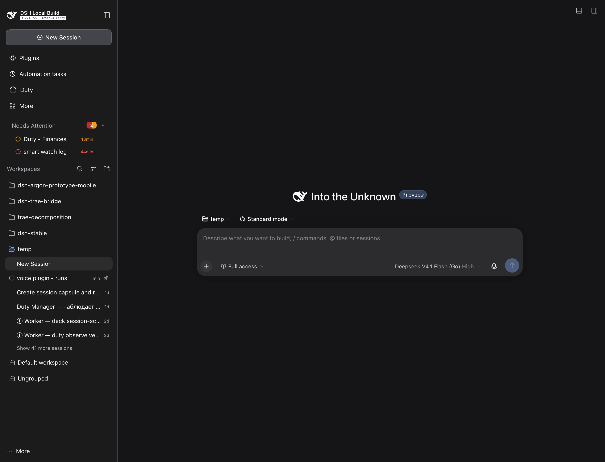
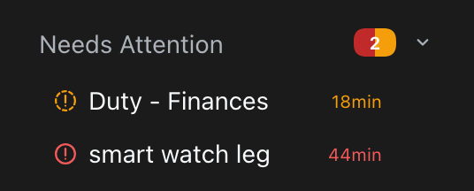
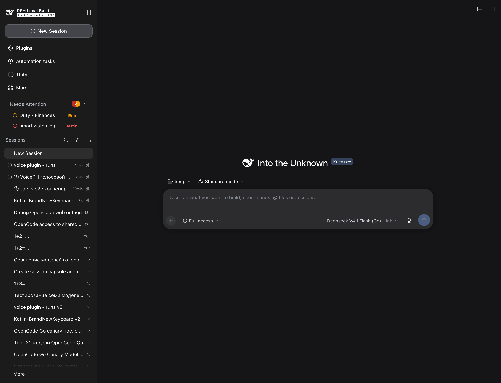

# dsh-needs-attention

A client-only plugin for [DeepSeek Harness](https://github.com/deepseek-ai/deepseek-harness) that puts a
**Needs Attention** block at the top of the web sidebar: the sessions whose latest turn ended in an error.

| red | amber |
|---|---|
| fatal turn error or abort — 413, 5xx, auth, model failure | 429 / rate-limit pressure |

中文摘要：一个只改前端的 DSH 插件，在侧边栏顶部显示"需要注意"的会话——最近一轮以错误结束的会话
（红色＝致命错误，琥珀色＝429 限流）。点击即可跳到该会话。

Zero core edits: one host route + one DOM-anchor client injection.

## Why

The sidebar is ordered by recency. Nothing in it says which lane is *stuck*: a session that died on a
413, one waiting for a turn that never came, one that has been rate-limited for ten minutes. With more
than a handful of parallel sessions you either remember or open them one by one.

Recency answers "what did I touch last". This block answers "what needs me now".

## How it works

**Host half** (`index.mjs`, `src/host.mjs`, `src/scanner.mjs`)

- On request, scans the session log directory (default `$DSH_HOME/sessions`, else `~/.dsh/sessions`):
  mtime cache, tail-only reads, 20 s throttle, event-loop yield every 2000 lines, a re-read floor for
  large logs.
- Classifies the latest terminal event per session (`turn/end`): fatal → red, rate limit → amber.
- Serves `GET /api/dsh-needs-attention/sessions`. Exact-table routes under `/api` are matched before the
  connection prefix gate, so the route carries its own admission guard (`connection.requestRejection()`,
  falling back to loopback-only) and redacts secrets from log text before it leaves the process.

**Browser half** (`src/client.js`)

- Renders the block above the sidebar's **first section header**, anchored structurally
  (`[class*="_sectionLabel"]` whose text is `Workspaces` / `工作区` / `Sessions` / `会话`, with a
  structural fallback). This matters: in flat view the first header says `Sessions`, in grouped view
  `Workspaces` — a text-only anchor silently disappears in one of the two modes.
- One row per session: title, age, reason, colour; click opens it. Collapses to a single header line;
  6-row group with scroll and "+N more"; `aria-label` and keyboard parity.

## Screenshots

Captured on a live lane, 2026-11-01 (`docs/screenshots/`):







## Status and limitations

- v0.2.0, running in one lane. `node --test tests/*.test.mjs` → 24 tests (anchor contract, classifier,
  polling, degraded mode, route fixture, scanner).
- The *attention model is heuristic*: it infers "needs attention" from terminal events in the log, not
  from a first-class session state. A core implementation should own that model — the plugin only
  renders it.
- One host, one user, sessions on the local filesystem. Not tested with remote or multi-user setups.

## Idea for core

This plugin is a proof that the slot is cheap and that the state is already there. What we would ask a
core implementation to own:

1. the definition of "needs attention" (which states count, thresholds, dismissal semantics);
2. the state itself, instead of a log scan;
3. the renderer can stay a plugin — or move in, whichever you prefer.

Discussion thread: see the *Ideas* post linking this repository.

## Install

Not on the npm registry yet, but installable straight from git (verified in a clean directory):
`npm i github:almazom/dsh-needs-attention` → one package, four seconds, all files present.

Then mount it into a profile — dependency plus one bundle row:

```jsonc
// profile package.json
{
  "dependencies": { "@almazom/dsh-needs-attention": "github:almazom/dsh-needs-attention" },
  "dsh": { "profile": { "bundles": [{ "name": "@almazom/dsh-needs-attention", "row": "needs-attention" }] } }
}
```

Restart the lane, then reload the web UI. Requirements: DSH `>=0.2.0-rc.1`, a profile whose
`dsh.profile.bundles` you can edit, and read access to the local session logs (`$DSH_HOME/sessions`,
default `~/.dsh/sessions`).

## License

MIT — see [LICENSE](LICENSE).
